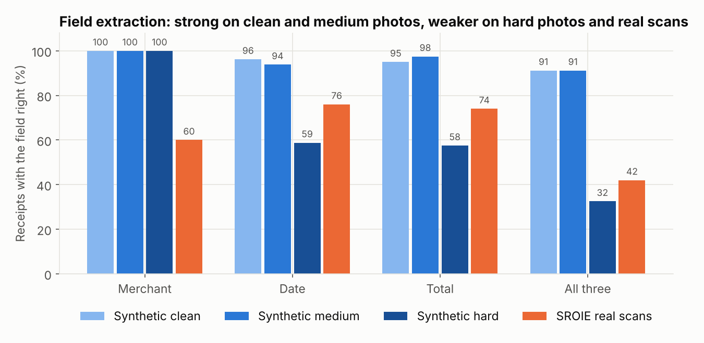
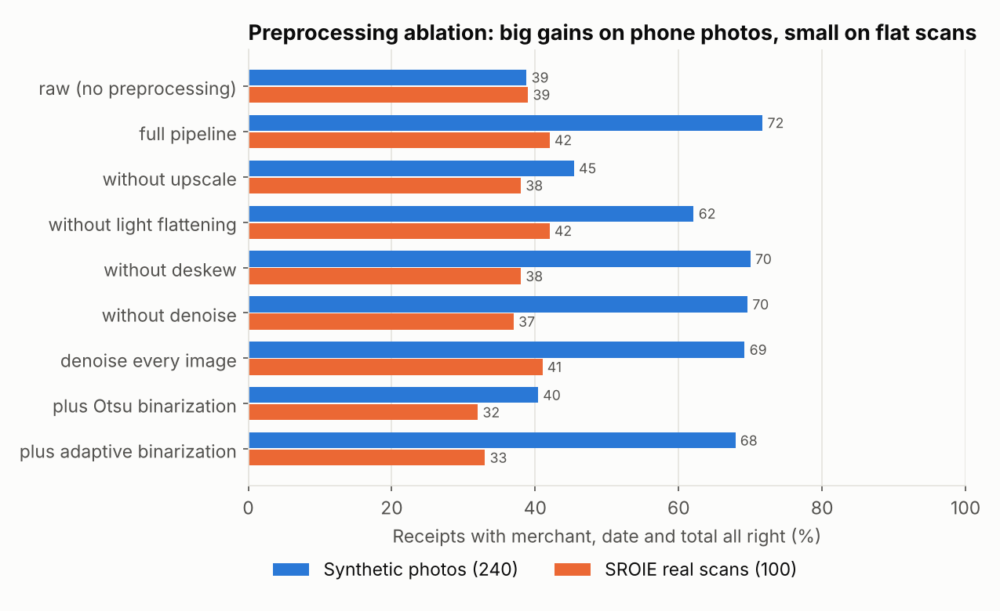
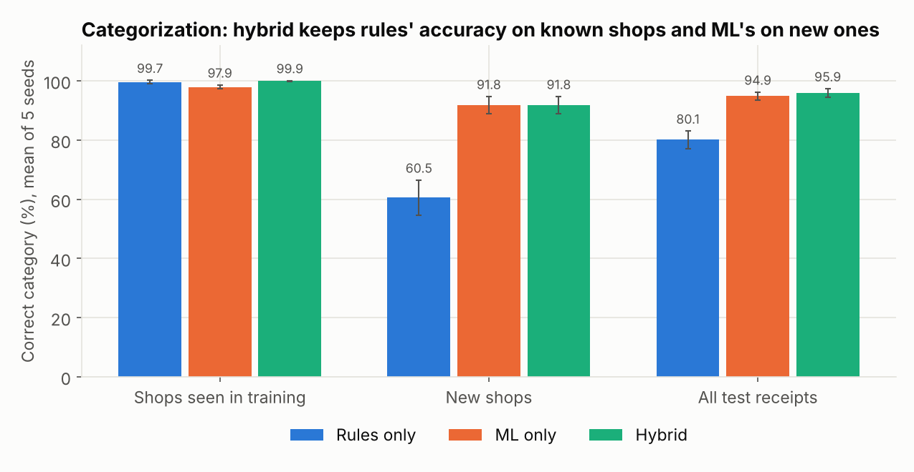
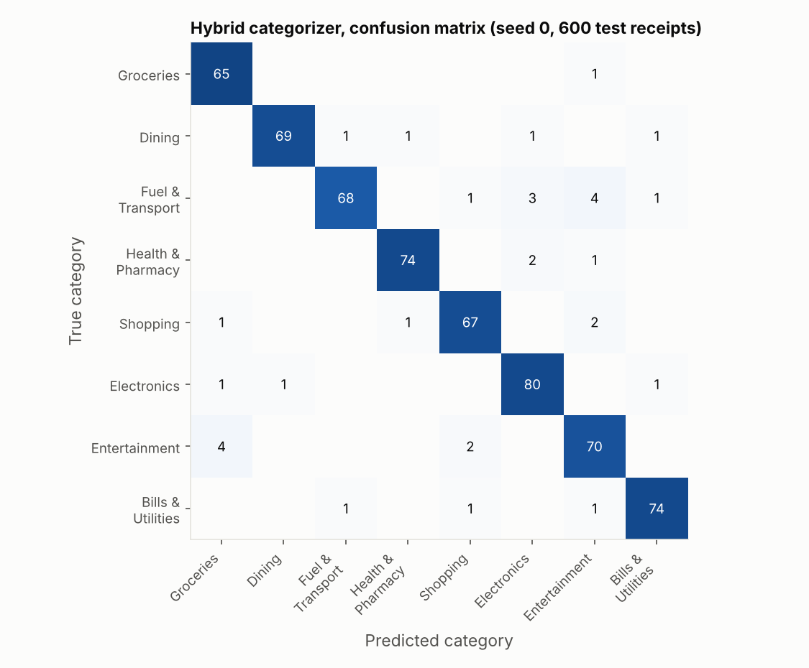
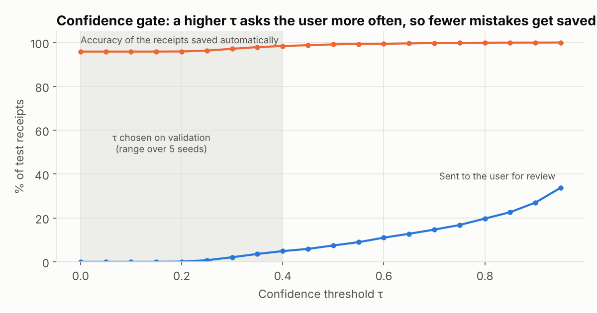
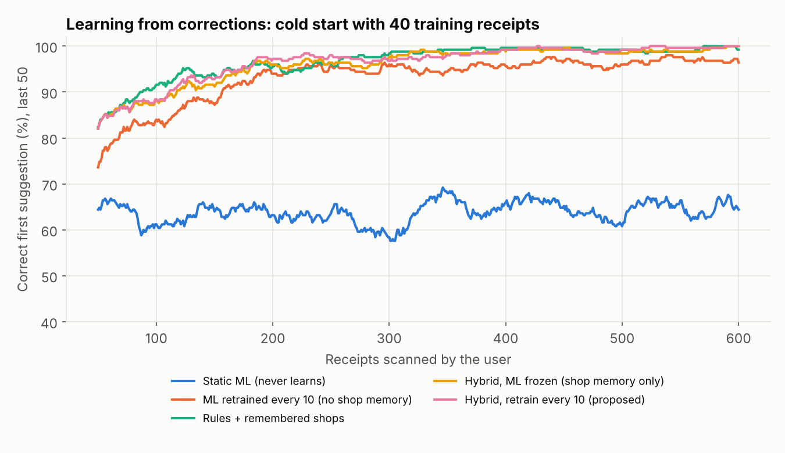
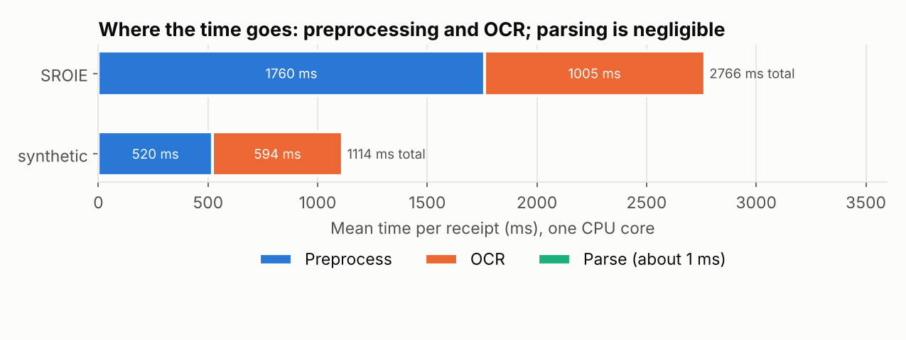

# Results

Every number here was produced by `python experiments/run_all.py` on the code in this folder. Machine: x86_64, Python 3.13.18, Tesseract 5.3.4.

## Algorithm flow

How one receipt goes from a photo to a saved, categorized expense. Each stage is one module in `src/expense_tracker/`, and `pipeline.py` chains them.

```
 receipt photo
      │
      ▼
 ┌──────────────────────────┐
 │ 1. PREPROCESS            │  preprocess.py   (OpenCV)
 │   grayscale              │
 │   upscale to ≥ 1000 px   │
 │   flatten lighting       │
 │   deskew (−6°…+6°)       │
 │   median filter if soft  │
 └────────────┬─────────────┘
              ▼
 ┌──────────────────────────┐
 │ 2. OCR                   │  ocr.py   (Tesseract 5, LSTM, psm 4)
 │   words + boxes + conf   │
 │   → group into lines     │
 │   → merge same-row lines │
 └────────────┬─────────────┘
              ▼
 ┌──────────────────────────┐
 │ 3. PARSE                 │  parser.py   (regex + layout rules)
 │   merchant, date, total, │
 │   items, GSTIN           │
 └────────────┬─────────────┘
              ▼
 ┌──────────────────────────┐
 │ 4. CATEGORIZE (hybrid)   │  categorizer.py
 │   shop list → ML → gate  │
 └────────────┬─────────────┘
              ▼
   category + confidence ──► needs review?  ── yes ──► user picks / corrects
                                   │                          │
                                   no                         ▼
                                   ▼                   5. LEARN (feedback)
                                 saved  ◄──────────────  update shop list,
                                                         retrain every k = 10
```

### 1. Preprocess (`preprocess.py`)

```
function PREPROCESS(img):
    g ← grayscale(img)
    sharpness ← variance(Laplacian(g))                        # measured on the original photo
    if width(g) < 1000: g ← resize(g, width = 1000)          # letters ~20–30 px tall
    bg ← morphological_close(g, kernel wider than strokes)    # estimate of the blank paper
    g ← g / bg · 255                                          # remove shadows / uneven light
    # deskew, projection profile on an Otsu-binarized copy:
    score(θ) ← Σ (diff(row_sums(rotate(bw, θ))))²             # sharp text/gap alternation
    θ* ← best θ in −6°…+6° (0.5° steps), then refine ±0.4° (0.1° steps)
    if |θ*| ≥ 0.2°: g ← rotate(g, θ*)
    if sharpness < 1500: g ← median_filter(g, 3×3)            # only soft images
    return g                                                  # no binarization (ablation, §3)
```

### 2. OCR (`ocr.py`)

```
function OCR(g):
    words ← tesseract(g, psm = 4)               # text, bounding box, confidence per word
    lines ← group words by Tesseract's (block, paragraph, line)
    sort lines by vertical centre
    join lines whose centres differ by ≤ half a line height and that don't overlap horizontally
                                                # keeps "TOTAL ...... 450.00" on one line
    return lines top to bottom
```

### 3. Parse (`parser.py`)

```
function PARSE(lines):
    fix O/D/Q→0, l/I/|→1, S→5, B→8, Z→2 only inside tokens that are mostly digits
    TOTAL:
        candidates ← lines with a total keyword, excluding Sub Total / Total Qty / Total Tax
        stop at "GST SUMMARY" tables
        prefer strong keywords (Grand Total, Net Amount, Amount Payable) over plain "Total"
        among equals take the last one before Cash / Change
        if none: largest amount that is not cash tendered or change
    DATE:
        try 7 formats (dd/mm/yyyy, dd.mm.yy, dd-Mon-yyyy, yyyy-mm-dd, ...), day first
        fall back to month first if day-first is impossible
        score each date: +2 if its line says "Date"/"Dt", +1 for a 4-digit year, +1 if year ≥ 2015
        take the highest score
    MERCHANT:
        plausible ← first 6 lines that are mostly letters and not a header, address or phone line
        return the first plausible line with a business word (Store, Medicals, Restaurant, Sdn Bhd, ...)
        else the first plausible line
    ITEMS:
        lines between merchant and total that end in a price, with price and qty removed
    return (merchant, date, total, items, gstin)
```

### 4. Categorize: hybrid (`categorizer.py`)

Rules only, ML only and hybrid implement the same `fit` / `predict` interface (Strategy pattern), so they are compared on identical data (§4).

```
function CATEGORIZE(merchant, items):
    m ← normalize(merchant)                     # lowercase, strip punctuation, Pvt/Ltd/M/s
    if m ∈ ShopList:                    return (ShopList[m], 1.0, RULE)
    if fuzzy(m, s) ≥ 0.9 and fuzzy(first_word(m), first_word(s)) ≥ 0.75 for some s ∈ ShopList:
                                        return (ShopList[s], 1.0, RULE)
    x ← [ TF-IDF word 1–2 grams + char 3–5 grams ](m)  ⊕  [ same ](items)
    (c, p) ← argmax LogisticRegression(x)       # C chosen on validation
    if p < τ:                           return (c, p, NEEDS_REVIEW)   # ask the user
    return (c, p, ML)
```

Character n-grams make the model tolerant of OCR typos (`paracetam0l`) and POS abbreviations (`PNR BTR MSL`); the first-word check stops generic names (`Sri Enterprises` / `Sai Enterprises`) from being treated as the same shop.

### 5. Learn from the user (`HybridCategorizer.feedback`)

```
function ON_FEEDBACK(merchant, items, c*):      # user corrected or confirmed a category
    ShopList[normalize(merchant)] ← c*          # takes effect on the very next receipt
    TrainSet ← TrainSet ∪ {(merchant, items, c*)}
    pending ← pending + 1
    if pending ≥ k (= 10):
        retrain LogisticRegression on TrainSet
        pending ← 0
```

The shop list handles shops the user returns to; retraining is what improves guesses at shops never seen before (§7).

### In the web app (`api.py`, `storage.py`)

```
POST  /api/receipts         image → PREPROCESS → OCR → PARSE → CATEGORIZE → save to SQLite
PATCH /api/expenses/{id}    new category → ON_FEEDBACK → save model to disk
GET   /api/summary          totals by category and by month for the dashboard
```

## Data

- **Synthetic receipts.** Indian shop bills generated with known answers (see `src/expense_tracker/synthetic.py`). 8 categories, 480 shops, split 60/20/20 into shops seen in training, new shops for validation and new shops for test. 1,500 training receipts, 300 validation, 600 test (half from known shops, half from new ones). Item names held out of training, abbreviated POS-style names, generic shop names and mixed baskets make categorization realistic rather than trivial.
- **Synthetic photos.** 80 test receipts rendered at three levels (clean; medium: tilt up to 2.5°, blur, smaller, uneven light; hard: tilt 2.5–5°, more blur and noise, faded ink, low resolution) = 240 images. Validation: 40 receipts × 3 = 120 images.
- **Real scans.** SROIE (ICDAR 2019) Malaysian receipts with labelled company, date and total. Receipts 000–049 were used while writing the parser rules (dev); 100 others, sampled with a fixed seed, are used only for the final numbers (test).

## 1. Choosing the settings (dev sets only)

| Preprocessing | Page mode | Synthetic dev, all 3 fields right | SROIE dev, all 3 right |
|---|---|---|---|
| raw (no preprocessing) | psm 4 | 35.0% | 26.0% |
| full pipeline | psm 4 | 66.7% | 40.0% |
| without upscale | psm 4 | 40.8% | 32.0% |
| without light flattening | psm 4 | 58.3% | 40.0% |
| without deskew | psm 4 | 65.0% | 36.0% |
| without denoise | psm 4 | 63.3% | 30.0% |
| denoise every image | psm 4 | 65.8% | 34.0% |
| plus Otsu binarization | psm 4 | 40.8% | 22.0% |
| plus adaptive binarization | psm 4 | 69.2% | 24.0% |
| raw (no preprocessing) | psm 6 | 61.7% | 32.0% |
| full pipeline | psm 6 | 74.2% | 32.0% |

Chosen: **full pipeline, psm 4** (best average of the two dev sets).

## 2. Field extraction on the test sets

Merchant counts as right when it matches the label at ≥ 90% character similarity (OCR often drops a letter); exact matches are shown too. Date and total must match exactly.

| Test set | n | Merchant (fuzzy) | Merchant (exact) | Date | Total | All three | Item recall |
|---|---|---|---|---|---|---|---|
| clean | 80 | 100.0% | 100.0% | 96.2% | 95.0% | 91.2% | 81.1% |
| medium | 80 | 100.0% | 100.0% | 93.8% | 97.5% | 91.2% | 86.2% |
| hard | 80 | 100.0% | 100.0% | 58.8% | 57.5% | 32.5% | 63.9% |
| synthetic (all) | 240 | 100.0% | 100.0% | 82.9% | 83.3% | 71.7% | 77.0% |
| SROIE real scans | 100 | 60.0% | 40.0% | 76.0% | 74.0% | 42.0% | – |



The parser gets every synthetic receipt right when given perfect text (checked in the tests), so the drop on hard photos is OCR errors. The synthetic receipts share print conventions with the parser rules, so they flatter it; the SROIE numbers are the honest real-world estimate.

## 3. Preprocessing ablation (test sets)

| Setting | Synthetic all 3 | clean | medium | hard | SROIE all 3 |
|---|---|---|---|---|---|
| raw (no preprocessing) | 38.8% | 83.8% | 32.5% | 0.0% | 39.0% |
| full pipeline | 71.7% | 91.2% | 91.2% | 32.5% | 42.0% |
| without upscale | 45.4% | 85.0% | 45.0% | 6.2% | 38.0% |
| without light flattening | 62.1% | 91.2% | 95.0% | 0.0% | 42.0% |
| without deskew | 70.0% | 91.2% | 92.5% | 26.2% | 38.0% |
| without denoise | 69.6% | 91.2% | 90.0% | 27.5% | 37.0% |
| denoise every image | 69.2% | 83.8% | 91.2% | 32.5% | 41.0% |
| plus Otsu binarization | 40.4% | 98.8% | 11.2% | 11.2% | 32.0% |
| plus adaptive binarization | 67.9% | 97.5% | 97.5% | 8.8% | 33.0% |



On phone-style photos every step helps; upscaling matters most, and light flattening is what makes the hard photos readable at all. On SROIE's flat, evenly lit scans the steps add little (39% raw vs 42% full). Binarization helps sharp clean images but wrecks the soft ones, so it is left off.

## 4. Categorization: rules only vs ML only vs hybrid

Same training data for all three. Mean ± standard deviation over 5 random seeds (each seed generates new shops and receipts). `C` (regularization) and τ were chosen on the validation split of each seed.

| Method | Accuracy | Macro-F1 | Known shops | New shops | Coverage |
|---|---|---|---|---|---|
| Rules only | 80.1 ± 2.9 | 88.4 ± 1.6 | 99.7 | 60.5 | 80.4 |
| ML only | 94.9 ± 1.3 | 94.9 ± 1.3 | 97.9 | 91.8 | 100.0 |
| Hybrid | 95.9 ± 1.5 | 95.9 ± 1.4 | 99.9 | 91.8 | 100.0 |

Coverage is the share of receipts that get a category at all; the rules give up on shops they don't recognise. The hybrid answered 49.8% of test receipts from its shop list and the rest with the model.



Per-category F1 (mean of 5 seeds):

| Category | Rules only | ML only | Hybrid |
|---|---|---|---|
| Groceries | 83.7 | 94.2 | 95.1 |
| Dining | 90.8 | 95.9 | 96.5 |
| Fuel & Transport | 91.1 | 94.4 | 95.7 |
| Health & Pharmacy | 93.5 | 96.5 | 97.2 |
| Shopping | 88.0 | 92.9 | 94.1 |
| Electronics | 84.0 | 94.8 | 96.1 |
| Entertainment | 90.1 | 94.3 | 95.7 |
| Bills & Utilities | 86.4 | 96.0 | 96.7 |



## 5. The confidence gate τ

τ was chosen as the smallest value that keeps the accuracy of automatically saved receipts at or above 97% on validation. Chosen τ per seed: 0.4, 0.4, 0.0, 0.0, 0.0.

On test: **1.3%** of receipts were sent to the user, the ones saved automatically were **96.8%** correct, and after the user fixes the flagged ones overall accuracy is **96.8%** (mean of 5 seeds).

In 3 of 5 seeds the hybrid already reached 97% on validation without asking the user, so τ = 0 was chosen and the gate stayed off. The curve shows the trade-off if you want fewer mistakes saved: at τ = 0.5 about 7.4% of receipts go to the user and 99.1% of the rest are right.



## 6. End to end: category from OCR output

The categorizers trained on clean text, then fed the merchant and items the OCR pipeline read from the 240 synthetic test photos (seed 0).

| Input | Rules only | ML only | Hybrid |
|---|---|---|---|
| clean | 77.5 | 95.0 | 95.0 |
| medium | 77.5 | 96.2 | 96.2 |
| hard | 77.5 | 95.0 | 95.0 |
| text (no OCR) | 77.5 | 96.2 | 97.5 |

## 7. Learning from corrections

Cold start: each model starts from 40 training receipts (5 per category). One simulated user then scans 600 receipts from 60 shops they visit, some often and some rarely. The user corrects every wrong suggestion and confirms every flagged one. Mean of 5 seeds.

| Method | First 100 receipts | Last 200 receipts | New shops, 2nd half | Corrections | Confirmations |
|---|---|---|---|---|---|
| Static ML (never learns) | 62.8% | 64.2% | 62.5% | 217 | 0 |
| ML retrained every 10 (no shop memory) | 78.8% | 96.7% | 79.5% | 46 | 0 |
| Rules + remembered shops | 87.0% | 99.2% | 54.8% | 23 | 0 |
| Hybrid, ML frozen (shop memory only) | 85.2% | 99.2% | 62.5% | 27 | 22 |
| Hybrid, retrain every 10 (proposed) | 85.2% | 99.5% | 81.8% | 25 | 20 |



Remembering corrected shops does most of the work, because people go back to the same shops. Retraining the model is what helps at shops the user hasn't been to before (the 'new shops' column).

## 8. Speed

Mean time per receipt with one CPU core per receipt.

| Test set | Preprocess | OCR | Parse | Total (mean) | Total (95th percentile) |
|---|---|---|---|---|---|
| synthetic | 520 ms | 594 ms | 0.7 ms | 1114 ms | 1407 ms |
| SROIE | 1760 ms | 1005 ms | 1.1 ms | 2766 ms | 10761 ms |

On SROIE, preprocessing is the slow part: some scans are over 2,000 px wide and light flattening runs at full resolution. Shrinking very large images first would cut this.

Categorizing one receipt takes 2.3 ms; training the hybrid on 1,500 receipts takes 0.4 s.



## 9. Tests

73 passed in 15.73s. Line coverage of `src/expense_tracker`: **99%**. Full report: `results/test_report.txt`.

## Two fixes made after a first full run

Being open about this, since it affects how far the test numbers can be trusted:

1. **Denoising.** The first run filtered every image. On test, clean photos scored lower than medium ones because the median filter erased decimal points on sharp images. The fix (filter only soft images) and its threshold (sharpness 1500) were chosen on extra validation images and the SROIE dev set, not on test, and every experiment was then rerun from scratch.
2. **Fuzzy shop matching.** Checking end-to-end errors showed a new shop, 'Lanka Enterprises', matched to the known 'Apna Enterprises' because the generic word dominates the similarity. The same mistake happened on validation (2 to 12 receipts per seed), so the rule now also requires the first word of the name to match.

## Limitations

- Categorization is measured on synthetic data. The absolute numbers depend on how the generator was built; the comparisons between methods are the useful part. A set of real labelled Indian receipts is needed to confirm them.
- SROIE receipts are Malaysian; Indian receipts (GST lines, ₹, Hindi text) were only tested synthetically.
- Tesseract is run in English only. Bills printed in Hindi would need the `hin` language pack.
- Timings come from a 2-core cloud machine; a phone or laptop will differ.
